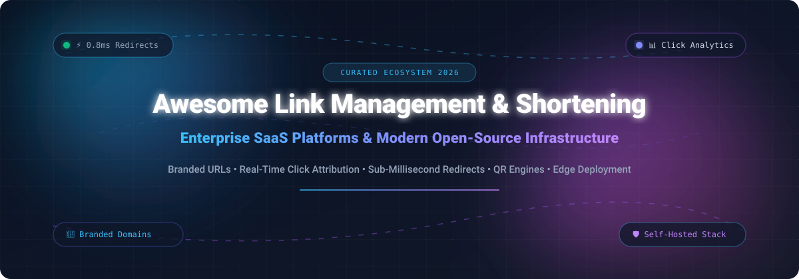

# ⚡ Awesome Link Management & Shortening

  <strong>A curated ecosystem of enterprise SaaS platforms, self-hosted open-source URL shorteners, branded link builders, and high-performance redirect infrastructure.</strong>

  
  
  
  
  
  

  <a href="#-sector-overview--market-dynamics">Sector Overview</a> •
  <a href="#-saas--hosted-platforms">SaaS Platforms</a> •
  <a href="#-open-source-github-projects">Open-Source Repositories</a> •
  <a href="#-architectural-frameworks">Architecture</a> •
  <a href="#-how-to-contribute">Contribute</a> •
  <a href="#-star-history">Star History</a> •
  <a href="#-support--sponsorship">Support</a>

---

## 📈 Sector Overview & Market Dynamics

The global link management, URL shortening, and deep linking market is estimated at **$1.8 billion to $2.4 billion**, expanding at a ~14% CAGR fueled by digital marketing attribution, mobile omnichannel experiences, and enterprise fraud prevention. The sector demonstrates **moderate-to-high fragmentation** at the developer and utility tier (dozens of lightweight SaaS utilities and self-hosted tools), but transitions into **concentrated, winner-take-most dynamics** within specialized sub-sectors—particularly mobile deep linking (dominated by AppsFlyer and Branch.io) and scaled enterprise brand management (led by Bitly and Rebrandly).

---

## ☁️ SaaS / Hosted Platforms

Below is an overview of the top hosted link management services, ordered by company size (valuation / estimated annual revenue in descending order).

| Platform | Company Size (Valuation / Est. Revenue) | Starting Tier Pricing | Free Tier Limits / Trial | Key Capabilities & Specializations |
| :--- | :--- | :--- | :--- | :--- |
| **[AppsFlyer](https://www.appsflyer.com/)** | **$3.0B Valuation** (~$350M+ ARR) | $0.07 per conversion after free tier threshold | **12,000 free conversions/month** (Zero Plan, free forever) | Enterprise mobile measurement partner (MMP), deep linking (OneLink), fraud prevention & omnichannel attribution. |
| **[Branch.io](https://branch.io/)** | **$1.5B+ Valuation** (~$150M+ ARR) | $59/month (Launch Plan) | **Up to 10,000 monthly active users (MAUs)** free forever | Cross-platform deep linking, deferred deep links, app install attribution, and unified user journey tracking. |
| **[Bitly Enterprise](https://bitly.com/)** | **~$600M Valuation** (~$120M+ ARR) | $8/month (Core Plan billed annually, or $10/mo monthly) | **5 short links/month** and 3 QR codes/month (Free forever account) | Market-leading URL shortener with custom branded domains, QR code generation, link-in-bio pages, and click analytics. |
| **[Dub.co](https://dub.co/)** | **~$25M–$40M Valuation** (~$3M–$5M ARR) | $24/month (Pro Plan billed annually, or $30/mo monthly) | **250 short links/month** & 5,000 clicks/month (Free forever account) | Modern open-source link attribution engine with real-time analytics, programmatic API, geo/device routing, and affiliate tracking. |
| **[Rebrandly](https://www.rebrandly.com/)** | **~$50M Valuation** (~$15M ARR) | $13/month (Essentials Plan billed annually, or $15/mo monthly) | **10 branded links/month** across 1 custom domain with 2,500 clicks tracked (Free forever) | Enterprise branded short URLs with custom domains, 301 redirects, link retargeting, and UTM builders. |
| **[Short.io](https://short.io/)** | **~$15M–$25M Est. Value** (~$5M+ ARR) | $17/month (Personal Plan billed annually, or $20/mo monthly) | **1,000 short links** across 5 custom domains & 50,000 clicks/month (Free forever) | Developer-friendly white-label shortener, custom domains, deep linking, geofencing, and automatic SSL issuance. |
| **[BL.INK](https://www.bl.ink/)** | **~$15M–$20M Est. Value** (~$4M ARR) | $48/month (Expert Plan) | **21-day free trial** with full enterprise feature access (no free forever plan) | Branded link shortening, GS1 Digital Link QR codes, unlimited data capture, and enterprise compliance tracking. |
| **[Sniply](https://sniply.io/)** | **~$5M–$10M Est. Value** (~$2M ARR) | $29/month (Basic Plan) | **14-day free trial** with up to 500 links & 5,000 clicks (no free forever plan) | URL shortener with CTA overlay: display custom buttons, forms, and banners directly on any shared content. |
| **[TinyURL Pro](https://tinyurl.com/)** | **~$8M–$12M Est. Value** (~$3M ARR) | $9.99/month (Pro Plan billed annually, or $12.99/mo monthly) | **Unlimited generic short links** with standard redirection, but **0 custom alias / 0 tracking analytics** | Veteran web shortener providing fast, resilient short links, branded domains, and QR code generation. |
| **[Ow.ly](https://hootsuite.com/)** | **Part of Hootsuite ($1.2B)** | Included with Hootsuite plans from $99/month | **30-day free trial** of Hootsuite Professional (includes Ow.ly link shortening) | Native social media link shortener and engagement tracker integrated into the Hootsuite social dashboard. |

---

## 🛠️ Open-Source GitHub Projects

Explore the top self-hosted and open-source URL shorteners, ordered by GitHub stargazers count (descending).

| Repository & Stars | Tech Stack | License | Key Features & Architecture |
| :--- | :--- | :--- | :--- |
| **[dubinc/dub](https://github.com/dubinc/dub)**  | TypeScript, Next.js, Prisma, Upstash | AGPL-3.0 | Modern link attribution and management platform. Enterprise-grade alternative to Bitly with real-time analytics, custom domains, bio links, geo/device targeting, and comprehensive REST API. |
| **[YOURLS/YOURLS](https://github.com/YOURLS/YOURLS)**  | PHP, MySQL / MariaDB | MIT | "Your Own URL Shortener" — battle-tested veteran self-hosted shortener running for 15+ years. Features 200+ community plugins, bookmarklets, JSON/XML APIs, custom slugs, and minimal resource usage. |
| **[thedevs-network/kutt](https://github.com/thedevs-network/kutt)**  | Node.js, Express, React, PostgreSQL, Redis | MIT | Clean modern URL shortener with custom domains, link expiration dates, password protection, visit stats, RESTful API endpoints, and a browser extension. |
| **[miantiao-me/sink](https://github.com/miantiao-me/sink)**  | Nuxt 4, Cloudflare Workers, D1, KV | MIT | Ultra-fast serverless link shortener built on Cloudflare. Supports AI-assisted slugs, geo/device routing, near-real-time global analytics with 3D globe visualization, and zero server maintenance. |
| **[shlinkio/shlink](https://github.com/shlinkio/shlink)**  | PHP (Swoole / RoadRunner), Docker | MIT | Self-hosted URL shortener with CLI and REST API. Includes GeoLite2 IP location tracking, multi-domain support, QR codes, visit analytics with browser/OS breakdowns, and Prometheus metrics export. |
| **[cydrobolt/polr](https://github.com/cydrobolt/polr)**  | PHP, Lumen, MySQL | GPL-2.0 | Minimalist, robust open-source URL shortener with admin management dashboard, custom domains, granular permissions, detailed click metrics, and clean API access. |
| **[zws-im/zws](https://github.com/zws-im/zws)**  | TypeScript, Fastify, PostgreSQL | MIT | "Zero Width Shortener" — creates URLs using invisible zero-width spaces instead of standard alphanumeric slugs. Lightweight, Dockerized, and privacy-oriented. |
| **[xyTom/Url-Shorten-Worker](https://github.com/xyTom/Url-Shorten-Worker)**  | JavaScript, Cloudflare Workers, KV | MIT | Serverless URL shortener configured in minutes using Cloudflare Workers and KV storage. No servers, no containers, and near-zero latency globally. |
| **[SinTan1729/chhoto-url](https://github.com/SinTan1729/chhoto-url)**  | Rust, Actix-web, SQLite | MIT | Blazingly fast, lightweight URL shortener written in pure Rust. Single binary deployment, sub-millisecond response latency, and low memory footprint (<15MB RAM). |
| **[ldidry/lstu](https://github.com/ldidry/lstu)**  | Perl, Mojolicious, SQLite / PostgreSQL | WTFPL | "Let's Shorten That URL" — strict privacy-centric shortener that does not collect IP addresses or visitor logs. Features customizable short URLs, QR codes, and API. |
| **[sjdonado/bit](https://github.com/sjdonado/bit)**  | Crystal, Kemal, Redis | MIT | Compiled, high-throughput URL shortener built with Crystal. Designed for extreme concurrency, minimal memory footprint, and rapid Docker deployment. |
| **[changkun/redir](https://github.com/changkun/redir)**  | Go, PostgreSQL, Redis | MIT | Combined self-hosted shortener and Go vanity import redirection server. Includes semantic aliases, operator management dashboard, GDPR compliance views, and access controls. |
| **[azlux/Simple-URL-Shortener](https://github.com/azlux/Simple-URL-Shortener)**  | Python, Flask, SQLite | MIT | Keep-It-Simple URL shortener with zero bloat. Supports private or public short link generation, custom slugs, and lightweight deployment via Docker. |
| **[frikishaan/lynx](https://github.com/frikishaan/lynx)**  | PHP, Laravel, Filament, SQLite | MIT | Elegant self-hosted link shortener powered by SQLite and Filament Admin. Supports splash/choice pages, password-protected links, QR codes, teams, and domain routing. |
| **[numanrki/Brevio](https://github.com/numanrki/Brevio)**  | PHP, Laravel 12, Inertia.js, React 18, TypeScript | MIT | Full-featured self-hosted shortener with modern reactive UI. Offers short links, QR codes, bio link pages, deep linking, visit analytics, and REST API. |
| **[link-rift/link-rift](https://github.com/link-rift/link-rift)**  | Go, ClickHouse, Docker | MIT | Enterprise-grade self-hosted shortener engineered in Go for sub-millisecond redirects. Features ClickHouse-backed analytics, auto-SSL custom domains, A/B testing, and webhooks. |
| **[lnk-sh/lnk](https://github.com/lnk-sh/lnk)**  | Go, SQLite | MIT | Ultra-minimal single-binary shortener with SQLite persistence. Consumes under 20MB RAM, zero external dependencies, designed for headless microservice pipelines. |
| **[Ruizennis/Clishortener](https://github.com/Ruizennis/Clishortener)**  | Python, CLI | MIT | Command-line client interfacing with 14+ public and private shortening engines directly from your terminal. |

---

## 🏗️ Architectural Frameworks & Custom Setups

For engineering teams architecting custom, highly scalable link management pipelines:

- **Core Routing Engine**: Combine **[Shlink](https://github.com/shlinkio/shlink)** or **[Dub](https://github.com/dubinc/dub)** with Docker containers or serverless edge runtimes.
- **Serverless Edge Execution**: Deploy on **[Cloudflare Workers](https://github.com/miantiao-me/sink)** or AWS Lambda@Edge to execute HTTP 301/302 redirects with <10ms regional TTFB.
- **High-Throughput Analytics**: Offload event logging to **[ClickHouse](https://clickhouse.com/)** or **Kafka** to handle hundreds of millions of link clicks without bottlenecking the transactional database.
- **Content Management Extensions**: For WordPress, platforms like **LinksTrackly** and **Royal Links** supply native plugin-based link cloaking and affiliate parameter forwarding.

---

## 🤝 How to Contribute

Contributions are warmly welcomed! Help make this ecosystem resource the most accurate and up-to-date guide for link infrastructure.

1. 🍴 **Fork the repository**.
2. 📝 **Add or update an entry** in `README.md` maintaining table formats and exact metrics.
3. 🔍 **Verify details**: Include platform name, working URL, precise pricing/limits, and tech stack info.
4. 🚀 **Submit a Pull Request** with a descriptive summary of your additions.

---

## 🌟 Star History

---

## 💖 Support & Sponsorship

If you find this curated ecosystem directory helpful for your projects, infrastructure, or marketing stacks:

- ⭐ **Star this repository** to help others discover it!
- 🍴 **Fork and share** with colleagues and developer communities.
- ☕ **Buy a coffee & sponsor ongoing maintenance** via the [GitHub Sponsor Dashboard](https://github.com/sponsors/ishandutta2007).

---

## ⚖️ Disclaimer

- This is a community-curated directory intended for research, evaluation, and informational purposes.
- Link shortening services can be targeted for malicious phishing or spam; always configure rate limiting, abuse detection, and reporting workflows when self-hosting.
- Ensure compliance with privacy regulations (GDPR, CCPA, ePrivacy) by anonymizing IP addresses and hashes within visitor analytics collectors.

---

  Maintained with ❤️ for developers, growth engineers, platform architects, and privacy-conscious organizations.

